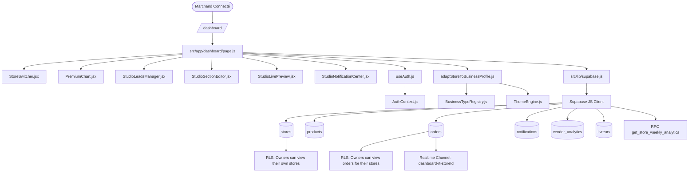

# AUDIT FORENSIC VESTYLE — 05_DEPENDENCY_MAP.md
**Date de l'audit :** 2026-10-01  
**Auteur :** Développeur Principal VesTyle  
**Objet :** Cartographie complète des chaînes de dépendances de bout en bout.

---

## 1. PRINCIPE DE LA CARTE DE DÉPENDANCES

Cette carte permet de visualiser avec une précision chirurgicale l'ensemble de la chaîne d'exécution :
```
USER ──► ROUTE ──► PAGE ──► COMPOSANTS ──► HOOKS ──► SERVICES/LIB ──► API HANDLERS ──► SUPABASE ──► TABLES ──► POLICIES/TRIGGERS/RPC
```
Elle sert de garde-fou absolu pour s'assurer qu'aucun déplacement ou refactoring futur ne brise un composant en cascade.

---

## 2. CARTES DE DÉPENDANCES DES FLUX PRINCIPAUX

### 2.1 FLUX MARCHAND — DASHBOARD VENDEUR (DOMAINE VENDEUR)



#### Chaîne 1 : Gestion des Produits & Stock
* **USER :** Marchand
* **ROUTE :** `/dashboard/products`
* **PAGE :** `src/app/dashboard/products/page.js`
* **COMPOSANTS :** `StockRow`, `StockBadge`, `AddProductModal.js`, `CsvImportExportModal.jsx`, `VoiceSearchButton.js`
* **HOOKS :** `useAuth()`, `useVoiceSearch()`
* **SERVICES / LIBS :** `src/lib/qrcode.js` (`getProductQrUrl`), `src/lib/csvHelper.js`, `src/lib/supabase.js`
* **API HANDLERS :** `/api/products`, `/api/products/generate-embeddings`
* **SUPABASE :** Client direct + API
* **TABLES :** `products`, `stock_logs`, `categories`, `stores`
* **POLICIES :** `Owners can manage products`, `Owner can view stock logs`, `Owner can insert stock logs`
* **IMPACT EN CAS DE DÉPLACEMENT :** Si la structure de `products` ou `stock_logs` est modifiée sans adaptateur, le dashboard de stock et l'historique des entrées/sorties cessent de fonctionner.

---

#### Chaîne 2 : Ajout de Produit avec IA
* **USER :** Marchand
* **ROUTE :** `/dashboard/add-product`
* **PAGE :** `src/app/dashboard/add-product/page.js`
* **COMPOSANTS :** `CategorySearch.js`, `ProductDescriptionAI.jsx`, `BackNavigation.js`
* **HOOKS :** `useAuth()`
* **SERVICES / LIBS :** `src/lib/cloudinary.js` (`uploadImage`, `deleteCloudinaryByUrl`), `src/lib/supabase.js`
* **API HANDLERS :** 
  - `/api/cloudinary` (Signature & upload Cloudinary)
  - `/api/ai/product-description` (Génération Mistral)
  - `/api/products/generate-embeddings` (Calcul embeddings vectoriels 1024D)
* **SUPABASE :** Client direct
* **TABLES :** `products`, `stores`, `categories`
* **TRIGGERS / RPC :** `upsert_product_embedding`
* **IMPACT EN CAS DE DÉPLACEMENT :** Les clés Cloudinary et Mistral sont requises.

---

#### Chaîne 3 : Traitement des Commandes & Livraisons
* **USER :** Marchand
* **ROUTE :** `/dashboard/orders`
* **PAGE :** `src/app/dashboard/orders/page.js`
* **COMPOSANTS :** `OrderTicket`, `BackNavigation.js`
* **HOOKS :** `useAuth()`
* **SERVICES / LIBS :** `src/lib/supabase.js`, `window.open` vers WhatsApp API (`wa.me`)
* **SUPABASE :** Client direct + Realtime
* **TABLES :** `orders`, `livreurs`, `stores`, `profiles`
* **POLICIES :** `Owners can view orders for their stores`, `Owners can update their store orders`
* **REALTIME :** Subscription sur table `orders` (`filter: store_id=eq.${storeId}`)
* **IMPACT EN CAS DE DÉPLACEMENT :** La mise à jour instantanée sonore et visuelle dépend du channel Supabase Realtime.

---

#### Chaîne 4 : Paramètres de l'Établissement & GPS
* **USER :** Marchand
* **ROUTE :** `/dashboard/settings`
* **PAGE :** `src/app/dashboard/settings/page.js`
* **COMPOSANTS :** Formulaire de configuration, `Link` retour
* **HOOKS :** `useAuth()`, `useDistance()` (géolocalisation navigateur `navigator.geolocation`)
* **SERVICES / LIBS :** `src/lib/business-types/BusinessTypeRegistry.js`, `src/lib/supabase.js`
* **TABLES :** `stores`
* **POLICIES :** `Owners can update their own stores`
* **IMPACT EN CAS DE DÉPLACEMENT :** Dépendance critique pour l'ancrage local (Douala, Yaoundé, GPS).

---

### 2.2 FLUX ACHETEUR — VITRINE, PANIER & CHECKOUT ATOMIQUE

```mermaid
graph TD
    Buyer([Acheteur / Visiteur]) --> RouteBoutique[/boutique/:slug/]
    RouteBoutique --> PageBoutique[src/app/boutique/[slug]/page.js]
    PageBoutique --> StoreClient[StorefrontClient.js]
    
    StoreClient --> UnivRenderer[UniversalStorefrontRenderer.jsx]
    StoreClient --> LegacyFallback[TemplateBoutique.jsx / TemplateTechPro.jsx]
    StoreClient --> ChatWidget[StoreChatWidget.jsx]
    StoreClient --> CatalogPdf[DownloadCatalogButton.jsx]
    
    StoreClient --> HookCart[useCart / CartContext.js]
    StoreClient --> LibBP[adaptStoreToBusinessProfile]
    
    StoreClient --> SupaClient[Supabase JS Client]
    SupaClient --> ViewStoresPub[(stores_public)]
    SupaClient --> TabProducts[(products)]
    SupaClient --> TabModules[(store_modules)]
    
    Buyer --> RouteCart[/cart/]
    RouteCart --> PageCart[src/app/cart/page.js]
    PageCart --> ApiCheckout[/api/orders/checkout/]
    
    ApiCheckout --> RpcCheckout[RPC process_order_checkout]
    RpcCheckout --> TabOrdersWrite[(orders)]
    RpcCheckout --> TabStockWrite[(products - update stock)]
    RpcCheckout --> TabLogsWrite[(stock_logs - insert log)]
```

#### Chaîne 5 : Rendu de la Vitrine Publique
* **USER :** Visiteur / Client
* **ROUTE :** `/boutique/[slug]`
* **PAGE :** `src/app/boutique/[slug]/page.js` (SSR Metadata) + `StorefrontClient.js` (CSR)
* **COMPOSANTS :** `UniversalStorefrontRenderer.jsx`, `StoreChatWidget.jsx`, `DownloadCatalogButton.jsx`, fallback `TemplateComponent` (`TemplateTechPro`, `TemplateBoutique`, etc.)
* **HOOKS :** `useCart()`, `useRouter()`
* **SERVICES / LIBS :** `adaptStoreToBusinessProfile.js`, `getThemeById.js`, `normalizeStoreModules.mjs`, `src/lib/supabase.js`
* **TABLES / VUES :** `stores_public` (Vue sécurisée sans `draft_config`), `products`, `store_modules`
* **POLICIES :** Public SELECT sur `stores_public` et `products`.

---

#### Chaîne 6 : Checkout Atomique & Idempotent
* **USER :** Client au panier
* **ROUTE :** `/cart`
* **PAGE :** `src/app/cart/page.js`
* **COMPOSANTS :** `DeliveryEstimator.jsx`, `InteractiveMap.js`
* **HOOKS :** `useCart()`, `useDistance()`
* **API HANDLER :** `/api/orders/checkout` (Next.js Serverless Route Handler)
* **SERVICES / LIBS :** `src/lib/supabaseAdmin.js` (`service_role`)
* **DATABASE LOGIC :** **RPC `process_order_checkout`**
  - Verrouille les produits avec `FOR UPDATE`
  - Re-vérifie le stock côté PostgreSQL
  - Crée la commande avec `idempotency_key`
  - Décrémente le stock de façon atomique
  - Écrit dans `stock_logs`
* **TABLES :** `orders`, `products`, `stock_logs`, `stores`
* **SÉCURITÉ :** RPC restreinte au `service_role`. Le prix provient exclusivement de la base (jamais du client).

---

### 2.3 FLUX CRÉATION / ONBOARDING (WIZARD 4 ÉTAPES)

* **USER :** Nouveau Marchand
* **ROUTE :** `/onboarding`
* **PAGE :** `src/app/onboarding/page.js`
* **COMPOSANTS :** `OnboardingWizard.tsx`, `StorefrontRenderer.tsx`
* **HOOKS :** `useOnboarding()`, `useAuth()`
* **CONTEXTE :** `OnboardingContext.tsx`
* **MOTEUR / CORE :** `LocalDesignRegistry.ts`, `VestinAdaptationEngine.ts`, `smartActivityDeducer.js`
* **DESIGNS CANONIQUES :** `VST_DSN_PRESTIGE_ATELIER_001` à `006`
* **API HANDLER :** `/api/ai/builder-orchestrator`, `/api/ai/generate-store`, `/api/store/create`
* **TABLES :** `stores`, `products`, `store_modules`
* **POLICIES :** `Owners can insert their own stores`

---

## 3. MATRICE DE VULNÉRABILITÉ EN CAS DE MODIFICATION

| Élément | Dépendances Amont | Dépendances Aval | Risque si Déplacé | Précaution Requise |
| :--- | :--- | :--- | :---: | :--- |
| `stores` (Table) | Partout | 100% du projet | 🔴 CRITIQUE | **Ne jamais renommer ni altérer sans rétrocompatibilité** |
| `products` (Table) | Dashboard, Search, Cart | Checkout RPC, Visual Search | 🔴 CRITIQUE | Conserver colonnes `price`, `stock_quantity`, `image_embedding_1024` |
| `orders` (Table) | Dashboard Orders, Checkout | RPC Checkout, Realtime, Suivi | 🔴 CRITIQUE | Conserver la structure des statuts et `order_items` |
| `stores_public` (Vue) | StorefrontClient, Discovery | Rendu public | 🟠 ÉLEVÉ | Doit toujours renvoyer les colonnes publiques |
| `AuthContext.js` | Supabase Auth | Tous les Dashboards | 🔴 CRITIQUE | Maintenir la fourniture de `store` et `stores` |
| `process_order_checkout` (RPC) | `/api/orders/checkout` | PostgreSQL Locks, Stock | 🔴 CRITIQUE | **Ne pas modifier la signature SQL** |
