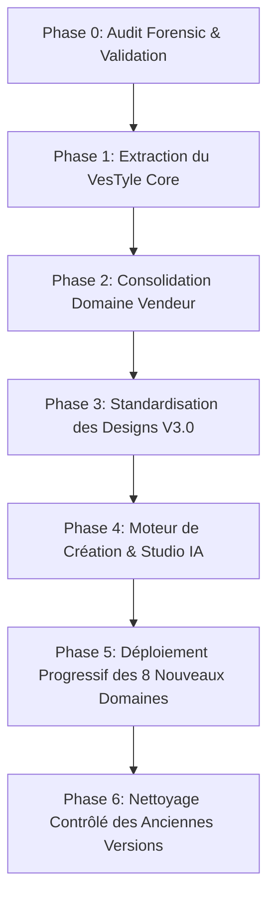

# AUDIT FORENSIC VESTYLE — 10_MIGRATION_PLAN.md
**Date de l'audit :** 2026-10-01  
**Auteur :** Développeur Principal VesTyle  
**Objet :** Plan d'exécution et feuille de route séquentielle pour la migration non-destructive vers l'architecture VesTyle.

---

## 1. PRINCIPES DIRECTEURS DE LA MIGRATION

1. **Zéro Interruption de Service :** Les boutiques en production et le Dashboard Vendeur existant ne doivent subir aucune régression ni interruption.
2. **Zéro Suppression Prématurée :** Les anciennes tables et composants restent accessibles en lecture/fallback tant que la nouvelle couche n'a pas atteint 100% de parité fonctionnelle et de validation.
3. **Migration par Incréments Validés :** Chaque phase fait l'objet d'une validation rigoureuse avant le passage à la phase suivante.
4. **Séparation Stricte des Responsabilités :** Core commun, Domaines métier indépendants, Designs purement déclaratifs.

---

## 2. FEUILLE DE ROUTE SÉQUENTIELLE EN 6 PHASES

---

### PHASE 0 — AUDIT FORENSIC & VALIDATION (PHASE ACTUELLE)
* **Objectif :** Cartographie exhaustive, détection des risques, inventaire du schéma Supabase et formalisation de l'architecture cible.
* **Actions Réalisées :**
  - Production des 10 rapports d'audit complets dans `AUDIT_VESTYLE/`.
  - Aucune modification de base de données, aucune suppression de fichier, aucune migration destructive.
* **Livrables :** Dossier `AUDIT_VESTYLE/` complet et Résumé Exécutif pour validation par le Responsable.

---

### PHASE 1 — EXTRACTION DU VESTYLE CORE (FONDATIONS PARTAGÉES)
* **Objectif :** Isoler et standardiser les briques transverses sans modifier le comportement existant.
* **Chantiers Clés :**
  1. **Core Auth & Account :** Consolider `AuthContext` pour fournir l'accès multi-sites (1 compte -> N sites).
  2. **Core Site Model :** Standardiser la structure `Site` (associée à `domain` et `category`).
  3. **Core Leads Service :** Généraliser le gestionnaire de prospects `StudioLeadsManager` pour tous les types de formulaires.
  4. **Core Notifications & Media :** Centraliser les helpers Cloudinary, PDF, QR Code et Push FCM.
  5. **Core AI Gateway :** Unifier la passerelle vers Mistral AI pour les actions structurées.
* **Sécurité :** Les routes actuelles continuent d'utiliser leurs imports existants via des alias ou des ré-exports rétrocompatibles.

---

### PHASE 2 — CONSOLIDATION DU DOMAINE VENDEUR (DOMAINE #1)
* **Objectif :** Sanctuariser le Dashboard Vendeur existant comme implémentation de référence du `domain = vendeur`.
* **Chantiers Clés :**
  1. **Correction des liens orphelins :** Remplacer les 4 liens morts vers `/builder/*` par l'ouverture de l'éditeur de sections existant.
  2. **Sécurisation multi-boutiques :** Remplacer les requêtes `.eq('owner_id', id).single()` par un filtrage par `storeId` actif.
  3. **Vérification du catalogue & stock :** Garantir l'isolation des tables `products`, `orders`, `stock_logs`, `promotions`, `livreurs`.
  4. **Tests de non-régression :** Valider le flux complet : Ajout produit -> Fiche produit -> Panier -> RPC Checkout atomique -> Notification Vendeur -> Ticket de caisse.
* **Critère de Succès :** Le Dashboard Vendeur fonctionne de manière 100% autonome et fluide.

---

### PHASE 3 — STANDARDISATION DU CONTRAT DE DESIGN & DU RENDU UNIVERSEL
* **Objectif :** Faire du standard `DesignDefinition` (v3.0) l'unique contrat pour tous les gabarits visuels.
* **Chantiers Clés :**
  1. **Validation du contrat Zod :** `src/core/contracts/designDefinition.ts` devient la référence unique.
  2. **Homogénéisation des 6 Designs Canoniques :** Vérifier que `vst_dsn_001` à `006` déclarent correctement leurs `requiredCapabilities` et leurs `dataSlots`.
  3. **Unification du Moteur de Rendu :** `UniversalStorefrontRenderer.jsx` devient le moteur de rendu universel, alimenté par le `VestinAdaptationEngine`.
  4. **Passage de relais des Templates JSX :** Les anciens templates `Template*.jsx` restent en fallback ultime sans être modifiés.

---

### PHASE 4 — MOTEUR DE CRÉATION DE SITE & STUDIO DE PERSONNALISATION
* **Objectif :** Mettre en place les deux parcours de création et l'éditeur visuel en direct.
* **Chantiers Clés :**
  1. **Parcours A (Catalogue de Designs) :** Tunnel de sélection Domaine -> Catégorie -> Design -> Renseignement des infos -> Génération instantanée.
  2. **Parcours B (Génération Mistral) :** Analyse du prompt utilisateur par Mistral -> Détection Domaine/Catégorie/Design -> Compilation déterministe.
  3. **Studio de Personnalisation :** Intégration du `StorefrontEditor` avec prévisualisation temps réel (Split Desktop/Mobile) et sauvegarde exclusive dans `stores.draft_config`.
  4. **Protocole de Publication :** Bouton "Publier" copiant de manière atomique et validée `draft_config` vers `published_config`.

---

### PHASE 5 — DÉPLOIEMENT PROGRESSIF DES 8 NOUVEAUX DASHBOARDS
* **Objectif :** Créer les 8 dashboards spécialisés, un par un, en réutilisant le Core commun.
* **Ordre de Déploiement Recommandé :**
  1. **Dashboard Restauration** (`domain = restauration`) — Menu, plats, tables, commandes à emporter.
  2. **Dashboard Hébergement** (`domain = hebergement`) — Chambres, disponibilités, réservations, tarifs saisonniers.
  3. **Dashboard Services** (`domain = services`) — Prestations, créneaux de RDV, devis, gestion d'équipe.
  4. **Dashboard Éducation** (`domain = education`) — Formations, cours, sessions, inscriptions.
  5. **Dashboard Santé & Pharmacie** (`domain = sante`) — Consultations, garde, produits de santé.
  6. **Dashboard Immobilier & Transport** (`domain = immobilier_transport`) — Biens, véhicules, visites, locations.
  7. **Dashboard Création & Médias** (`domain = creation_medias`) — Portfolios, galeries, prestations de shooting.
  8. **Dashboard Organisations** (`domain = organisations`) — Entreprises, institutions, adhésions.

---

### PHASE 6 — NETTOYAGE CONTRÔLÉ DES ANCIENNES VERSIONS (POST-MIGRATION)
* **Objectif :** Nettoyer le code mort et les tables obsolètes une fois que tous les domaines et sites sont migrés avec succès.
* **Chantiers Clés :**
  1. Migration des anciennes configurations `store_modules` résiduelles vers le format `published_config`.
  2. Archivage sécurisé des tables V2 non utilisées (`devis_requests`, `events`, etc.).
  3. Dépréciation définitive des templates JSX monolithiques `src/templates/*`.
  4. Archivage des scripts de debug de la racine dans `scripts/archive/`.

---

## 3. MATRICE DES RISQUES ET GARANTIES DE REPLI

| Risque Potentiel | Probabilité | Impact | Mesure Préventive & Stratégie de Rollback |
| :--- | :---: | :---: | :--- |
| **Casse du Dashboard Vendeur** | Nulle | Critique | Le Dashboard Vendeur est sanctuarisé en Phase 2 sans modification de ses flux de données |
| **Incompatibilité d'un ancien Storefront** | Faible | Élevé | Le composant `UniversalStorefrontRenderer` conserve son `legacyTemplateFallback` |
| **Erreur de validation JSON dans le Studio** | Faible | Moyen | Tout enregistrement passe par la validation stricte `Zod` avant écriture dans `draft_config` |
| **Conflit de migration base de données** | Nulle | Critique | Aucune migration destructive (DROP/ALTER) n'est exécutée avant la Phase 6 finale |
